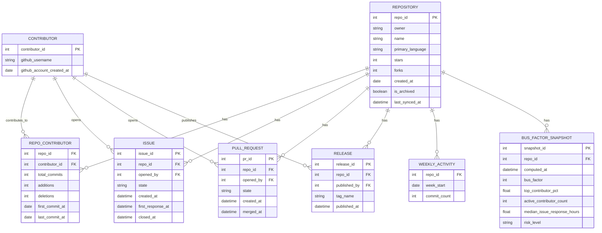

# Open-Source Maintainer Burnout & Bus Factor Tracker

*DBMS Project*

> [!abstract] Pitch
 "I can tell you which of your project's dependencies are one person away from going unmaintained."
 
## 1. Problem statement

Open-source software runs on a small number of unpaid or underpaid maintainers. When they burn out, disappear, or move on, downstream projects break with zero warning — the `left-pad` incident is the famous example, but it happens constantly at a smaller scale.

**Bus factor** is the number of people who could disappear from a project before it stalls. A bus factor of 1 means a single person's absence would kill the project. This project builds a system that estimates bus factor and burnout risk for real GitHub repositories using actual public data — not simulated data.

---

## 2. Feasibility assessment

> [!success] Verdict
> Highly feasible, with one important scoping decision.

| Factor | Assessment |
|---|---|
| Data availability | GitHub REST API is free, public, well-documented, requires only a personal access token |
| Rate limits | 5,000 requests/hour authenticated (60/hour unauthenticated) — plenty if you scope to 50–150 repos |
| Cost | $0 — no paid API tier needed |
| Time to working prototype | 1 sprint (schema + sync script + basic queries), ~1–2 weeks |
| Risk | Low, as long as you don't try to track *all* of GitHub — pick a curated repo list |

> [!warning] The one scoping trap to avoid
> Pulling every individual commit for popular repos (React has 20,000+ commits) will burn your rate limit fast. Instead, use GitHub's **pre-aggregated stats endpoints**:
> - `GET /repos/{owner}/{repo}/stats/contributors` → weekly commit/addition/deletion counts **per contributor**, one API call per repo
> - `GET /repos/{owner}/{repo}/stats/commit_activity` → total commits per week for the last year, one call
>
> This alone keeps the whole project comfortably inside your hourly quota even syncing 100+ repos.

### Recommended scope
Track **50–100 hand-picked repositories**, not a crawl of GitHub:
- [ ] Small but widely-depended-on utility libraries (the "next left-pad" risk zone)
- [ ] A few large, well-funded projects (React, Django) as a healthy-baseline contrast
- [ ] A few already-abandoned/archived repos as "known bad" test cases

---

## 3. What "bus factor" actually means

> [!quote] Working definition
> Bus factor = the smallest number of top contributors (by commits in the trailing 12 months) whose combined commits account for ≥50% of total recent activity.

Example: if one person made 70% of commits in the last year, bus factor = 1 (critical risk). If it takes the top 4 contributors combined to reach 50%, bus factor = 4 (healthier).

Secondary signals feeding the overall risk picture:

| Signal | What it tells you |
|---|---|
| Bus factor (commit concentration) | How dependent the project is on one person |
| Days since last commit | Is the project still active at all? |
| Median issue first-response time | Is the maintainer keeping up, or drowning? |
| Open issue backlog growth rate | Is the maintainer falling behind over time? |
| Contributor count trend (6-month) | Is the contributor base shrinking? |

These combine into a **risk score** (Critical / High / Medium / Healthy) — the analytical core of the project, and what makes it more than a CRUD app.

---

## 4. Data to collect

| Data | GitHub API endpoint | Notes |
|---|---|---|
| Repo metadata | `GET /repos/{owner}/{repo}` | stars, forks, language, created_at, archived flag |
| Contributors + commit stats | `GET /repos/{owner}/{repo}/stats/contributors` | pre-aggregated, 1 call per repo |
| Weekly commit activity | `GET /repos/{owner}/{repo}/stats/commit_activity` | trend detection |
| Issues | `GET /repos/{owner}/{repo}/issues` | filter `state=all`, paginate |
| Pull requests | `GET /repos/{owner}/{repo}/pulls` | state, merged_at, review activity |
| Releases | `GET /repos/{owner}/{repo}/releases` | shows if releases have slowed/stopped |
| Contributor profiles | `GET /users/{username}` | account age, public repo count |

> [!info] Prerequisite
> Generate a free **GitHub personal access token** (read-only, public repo scope) 
---


## 5. Database design

### 5.1 ER diagram



> [!note] Design notes
> - `REPO_CONTRIBUTOR` is a genuine associative entity, not just a join table — it carries its own attributes (`total_commits`, `additions`, `deletions`) that depend on the *combination* of repo + contributor. Clean example of a many-to-many relationship with attributes for the report.
> - `BUS_FACTOR_SNAPSHOT` is time-series — every re-sync inserts a new row rather than overwriting. This lets you show trend ("bus factor dropped from 4 to 1 over six months") and gives a natural excuse to use window functions.

### 5.2 Normalization talking points

> [!example] For your report
> - **1NF**: don't store contributor usernames as a comma-separated string on the repo row — that's exactly why `REPO_CONTRIBUTOR` exists as a separate table.
> - **2NF**: in `REPO_CONTRIBUTOR`, `total_commits` depends on the *full* composite key (repo_id + contributor_id), not on either part alone.
> - **3NF/BCNF**: keep computed/derived fields (like `risk_level`) out of `REPOSITORY` itself — they belong in `BUS_FACTOR_SNAPSHOT` since they're derived and change independently. Mixing them in would create update anomalies (stale risk scores).
- **1NF (First Normal Form):** Ensures **atomicity**. Each column must contain indivisible values (no arrays or comma-separated lists) and every row must be uniquely identifiable by a primary key. [[1](https://www.geeksforgeeks.org/dbms/normal-forms-in-dbms/)]


- **2NF (Second Normal Form):** Eliminates **partial dependencies**. The table must be in 1NF, and every non-key attribute must depend on the _entire_ primary key, not just a part of it (relevant only for composite keys). [[1](https://www.geeksforgeeks.org/dbms/normal-forms-in-dbms/)]


- **3NF (Third Normal Form):** Eliminates **transitive dependencies**. The table must be in 2NF, and no non-key attribute should depend on another non-key attribute. All attributes must depend directly on the primary key. [[1](https://www.geeksforgeeks.org/dbms/normal-forms-in-dbms/)]
---

## 6. Core queries / analytics

**Bus factor calculation using window functions** (PostgreSQL):

```sql
WITH ranked_contributors AS (
  SELECT
    repo_id,
    contributor_id,
    total_commits,
    SUM(total_commits) OVER (PARTITION BY repo_id) AS repo_total_commits,
    SUM(total_commits) OVER (
      PARTITION BY repo_id ORDER BY total_commits DESC
    ) AS running_total,
    ROW_NUMBER() OVER (
      PARTITION BY repo_id ORDER BY total_commits DESC
    ) AS contributor_rank
  FROM repo_contributor
)
SELECT repo_id, MIN(contributor_rank) AS bus_factor
FROM ranked_contributors
WHERE running_total >= 0.5 * repo_total_commits
GROUP BY repo_id;
```

**Repos trending toward risk** (using snapshot history):

```sql
SELECT r.name, s1.bus_factor AS bus_factor_now, s2.bus_factor AS bus_factor_6mo_ago
FROM bus_factor_snapshot s1
JOIN bus_factor_snapshot s2
  ON s1.repo_id = s2.repo_id
  AND s2.computed_at = s1.computed_at - INTERVAL '6 months'
JOIN repository r ON r.repo_id = s1.repo_id
WHERE s1.bus_factor < s2.bus_factor
ORDER BY (s2.bus_factor - s1.bus_factor) DESC;
```


---

## 7. Where transactions actually matter

Your sync job pulls data from several endpoints per repo (metadata, contributors, issues, releases) and then computes a new `BUS_FACTOR_SNAPSHOT`. If the process dies halfway — say, after updating `REPO_CONTRIBUTOR` but before inserting the new snapshot — the data is now inconsistent.

```sql
BEGIN;
  -- upsert repository metadata
  -- upsert repo_contributor rows
  -- insert new bus_factor_snapshot row
COMMIT;
```

> [!important] Why this matters
> If any step fails, `ROLLBACK` — the previous snapshot stays intact rather than getting corrupted. This is a real, defensible use of ACID atomicity (not a contrived textbook example), and worth a paragraph in your report.

---

## 8. System architecture

```
GitHub REST API
      │
      ▼
Sync Script (Python or Node, runs on a schedule)
      │  - pulls repo/contributor/issue/release data
      │  - upserts into relational tables (transaction-wrapped)
      │  - computes bus factor → inserts snapshot row
      ▼
PostgreSQL Database
      │
      ▼
Backend API (Flask/FastAPI or Express)
      │  - serves aggregated data to frontend
      ▼
Frontend Dashboard (React)
      │  - risk-ranked repo list
      │  - per-repo trend charts (bus factor over time)
      │  - "watchlist" of at-risk dependencies
```

---

## 9. Website 


> [!success] Why website ?
> - This is a data-exploration tool — people check dependency health occasionally, not on-the-go. No "on a bus, need this now" use case justifies native mobile.
> - A responsive web dashboard (React + Recharts) covers desktop and phone browsers with one codebase.
> - Want it to *feel* like an app? Make it an installable **PWA** — home-screen icon, offline shell, ~1 extra day of work.


### Stack Used


| Layer | Tool | Why |
|---|---|---|
| Database | PostgreSQL | Strong window function support, handles time-series snapshot queries well |
| Backend | Python + FastAPI | Fast to build, sync scripts + REST API in one codebase |
| Sync scheduling | `cron` or GitHub Actions | Keeps data fresh without manual re-runs |
| Frontend | React + Recharts or Chart.js | Bus-factor-over-time trend charts, risk-ranked tables |

---

## 10. Project phases

- [ ] **Phase 1** (2–3 days) — Finalize schema, set up PostgreSQL, generate GitHub PAT
- [ ] **Phase 2** (3–4 days) — Sync script for repo/contributor stats endpoints (single-repo proof of concept)
- [ ] **Phase 3** (3–4 days) — Extend sync to issues/releases, wrap in transactions, run across 50–100 repos
- [ ] **Phase 4** (3–4 days) — Bus factor + risk-scoring queries, populate `BUS_FACTOR_SNAPSHOT`
- [ ] **Phase 5** (2–3 days) — Backend API endpoints on top of the queries
- [ ] **Phase 6** (4–5 days) — Frontend dashboard (risk list, trend charts, repo detail view)
- [ ] **Phase 7** (3–4 days) — Polish, write up ER diagram/normalization discussion, prepare demo

> [!info] Total
> Roughly 3–4 weeks at a comfortable pace — compress or stretch based on your actual deadline.

---

## 11. Stretch goals

> [!tip] Only if you have time left
> - **NoSQL layer for issue/commit text** — store raw issue bodies and commit messages in MongoDB while structured metadata stays in PostgreSQL. Ties directly into the syllabus's Unit 3 case study on choosing the right database.
> - **Simple sentiment/burnout language detection** on maintainer's issue responses over time — even a basic keyword/length heuristic demonstrates the idea.
> - **Email/webhook alert** when a tracked repo crosses into "Critical" risk — shows the tool as something people would actually use.


---

## 12. What to demo

> [!success] The strongest demo proves the scoring works
> 1. Show a known-healthy project (large, well-staffed repo) scoring "Healthy."
> 2. Show a known-abandoned repo (archived or clearly dead) scoring "Critical."
> 3. Show the trend view for a repo whose bus factor visibly declined over the snapshots collected.
>
> That's the moment that convinces an evaluator this isn't just a database with a UI on top — it's answering a real question with real data.

---

## Related notes
- [[ER Diagram]]
- [[SQL Schema]]
- [[GitHub API Notes]]
