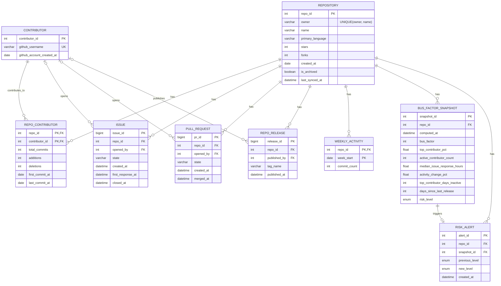

# Open-Source Maintainer Burnout & Bus Factor Tracker — Project Report

*DBMS end-semester project · FastAPI + React + MySQL 8.0*

## 1. Problem

Open-source software runs on a small number of unpaid or underpaid
maintainers. When they burn out, disappear or move on, downstream projects
break with no warning (the `left-pad` incident being the best-known example).

The **bus factor** of a project is the number of people who would have to
disappear before it stalls. This system estimates bus factor and burnout
risk for real GitHub repositories using public data from the GitHub REST API —
no simulated data.

## 2. Architecture

```
GitHub REST API
      │   repo metadata, contributor stats, weekly commit activity,
      │   issues (+ first comment), pull requests, releases
      ▼
scripts/sync_mysql.py   (daily via Windows Task Scheduler — scripts/register_sync_task.ps1)
      │   one transaction per repo: upsert all rows → compute snapshot
      ▼
MySQL 8.0  (9 tables · 1 view · 1 function · 1 procedure · 1 trigger)
      ▼
backend/main.py   FastAPI, read-only except add/remove repo
      ▼
frontend/         React + Recharts dashboard
```

The sync and the API are separated on purpose: syncing one repo costs
10–40 seconds of GitHub API calls, while every dashboard read is a
millisecond-scale SQL query over data already stored.

## 3. ER model



### Design notes

- **`REPO_CONTRIBUTOR` is an associative entity with its own attributes.**
  The many-to-many relationship between repositories and contributors
  carries `total_commits`, `additions`, `deletions` and first/last commit
  dates, all of which depend on the *pair*, not on either side alone.
- **`WEEKLY_ACTIVITY` is a weak entity.** It's identified by
  `(repo_id, week_start)` and has no meaning without its repository.
- **`BUS_FACTOR_SNAPSHOT` is append-only time-series data.** Every sync
  inserts a new row instead of overwriting, which is what makes trend
  analysis (`sp_declining_repos`) and alerts possible.
- **GitHub's own ids are used as primary keys** for issues, PRs and
  releases (`BIGINT`), so re-syncing upserts the same row instead of
  creating duplicates, and ids never collide across repositories.
- **Contributor foreign keys on issues/PRs/releases are nullable** (`|o`
  in the diagram): GitHub returns no user for deleted accounts.
- `release` is a reserved word in MySQL, hence `repo_release`.

### Referential integrity

Every child table references `repository(repo_id)` with `ON DELETE CASCADE`.
Removing a repo from the dashboard (`DELETE /api/repos/{owner}/{name}`) is a
single `DELETE FROM repository`, and MySQL removes its contributors' stats,
issues, PRs, releases, weekly activity, snapshots and alerts in the same
statement. `contributor` rows are shared across repos, so they're
deliberately *not* cascaded from repositories.

## 4. Normalization

All tables are in **BCNF**: in every table, the only non-trivial functional
dependencies have a candidate key on the left-hand side.

| Normal form | Where it shows up in this schema |
|---|---|
| **1NF** — atomic values | A repo's contributors are rows in `repo_contributor`, not a comma-separated list on `repository`. Weekly activity is one row per week, not an array column. |
| **2NF** — no partial dependency on a composite key | In `repo_contributor (repo_id, contributor_id)`, `total_commits` depends on the full key. `github_username` depends on `contributor_id` alone, so it lives in `contributor`, not here. Same for `weekly_activity`: `commit_count` needs both `repo_id` and `week_start`. |
| **3NF** — no transitive dependency | `risk_level` is derived from `bus_factor` and the burnout signals, and changes every sync, so it's kept out of `repository` and stored on the snapshot it was computed from. Putting it on `repository` would create update anomalies (a stale score with no record of when it was true). |
| **BCNF** | `repository` has two candidate keys (`repo_id` and `(owner, name)`), and both determine every other attribute. `contributor` likewise (`contributor_id`, `github_username`). |

**Deliberate denormalization.** `bus_factor_snapshot` stores computed values
(`bus_factor`, `top_contributor_pct`, ...) that could in principle be
recomputed from other tables. That's intentional: a snapshot records what
the numbers *were* at `computed_at`. The source tables are overwritten on
every sync, so the history could not be reconstructed later.

## 5. Transactions (ACID)

`sync_repo()` in `scripts/sync_mysql.py` runs every repo inside one
transaction (`autocommit = False`):

```
BEGIN
  upsert repository
  upsert contributors + repo_contributor
  upsert weekly_activity, issues, pull requests, releases
  INSERT bus_factor_snapshot          ← fires trg_snapshot_risk_alert
COMMIT          (ROLLBACK on any exception)
```

- **Atomicity.** If the script dies halfway (network error, GitHub rate
  limit, bad row), nothing for that repo is committed. The previous snapshot
  stays the latest one, so the dashboard never shows a score computed from
  half-updated data.
- **Consistency.** The trigger runs inside the same transaction, so a
  rolled-back sync can't leave an alert pointing at a snapshot that doesn't
  exist.
- **Network calls happen before `BEGIN`.** All GitHub requests (including
  up to 30 concurrent first-comment lookups) finish before the transaction
  opens, so a slow API never holds row locks.
- **Idempotent re-runs.** Every write is `INSERT ... ON DUPLICATE KEY UPDATE`
  keyed on natural or GitHub ids, so running the sync twice doesn't
  duplicate data. Only the snapshot (intentionally) appends.

## 6. SQL features used

### Window functions + CTE — bus factor (`compute_and_insert_snapshot`)

```sql
WITH ranked_contributors AS (
    SELECT contributor_id, total_commits,
           SUM(total_commits) OVER ()                            AS repo_total_commits,
           SUM(total_commits) OVER (ORDER BY total_commits DESC) AS running_total,
           ROW_NUMBER()       OVER (ORDER BY total_commits DESC) AS contributor_rank
    FROM repo_contributor
    WHERE repo_id = ?
)
SELECT MIN(CASE WHEN running_total >= 0.5 * repo_total_commits
                THEN contributor_rank END) AS bus_factor
FROM ranked_contributors;
```

The bus factor is the smallest number of top contributors who together
wrote at least 50% of the commits.

### Window-function median — issue response time

MySQL 8.0 before 8.0.28 has no `PERCENTILE_CONT`, so the median is the
average of the middle one or two rows ranked by `ROW_NUMBER()`.

### Conditional aggregation — activity trend

The commit-activity change compares `AVG(CASE WHEN week in last 12 weeks ...)`
against `AVG(CASE WHEN week in the 40 weeks before ...)` in a single pass
over `weekly_activity`.

### View — `v_repo_latest_snapshot`

Every repo joined to its newest snapshot (`LEFT JOIN`, so repos with no
snapshot still appear). The "latest row per group" logic was previously
repeated in four API endpoints. It now lives in the database once.

### Stored function — `fn_risk_rank(level)`

Maps `Healthy, Medium, High, Critical` to `1..4`. The `ENUM` stores levels in
the opposite order, so this is the single definition of "worse than". The
trigger, the procedure and the API's risk sort all use it.

### Stored procedure — `sp_declining_repos(p_days)`

For each repo, pairs the latest snapshot with the newest snapshot at least
`p_days` older, and returns repos whose bus factor fell or risk rose.

> **Bug fixed during development.** The first version joined on
> `s2.computed_at = s1.computed_at - INTERVAL 6 MONTH`. Snapshots are taken
> whenever the sync runs, so two are never exactly six months apart to the
> second, and the query always returned zero rows. The fix looks for the
> newest snapshot *at or before* the cut-off instead.

### Trigger — `trg_snapshot_risk_alert`

`AFTER INSERT ON bus_factor_snapshot`: reads the repo's previous snapshot
and, if the new risk level is worse, inserts a row into `risk_alert`. The
dashboard's "Recent risk increases" panel reads that table. A scalar
subquery is used instead of `SELECT ... INTO`, so a repo's first snapshot
(no previous row) simply yields `NULL`.

### Indexes

| Index | Serves |
|---|---|
| `UNIQUE (owner, name)` on `repository` | every lookup by URL path |
| `(repo_id, computed_at)` on `bus_factor_snapshot` | latest-snapshot subquery, trend endpoint, procedure, trigger |
| `repo_id` on `repo_contributor`, `issue` | per-repo aggregation in the snapshot computation |
| `created_at` on `risk_alert` | newest-first alert feed |

## 7. Risk scoring

The base level comes from the bus factor:

| Bus factor | Base level |
|---|---|
| 1 | Critical |
| 2 | High |
| 3–4 | Medium |
| 5+ | Healthy |

An **archived** repo is Critical outright. Each independent **burnout
signal** then raises the level by one (capped at Critical):

| Signal | Source | Threshold |
|---|---|---|
| Slow issue responses | `issue.first_response_at` (median) | > 30 days |
| Commit activity decline | `weekly_activity` | last 12 weeks ≥ 50% below the 40 weeks before |
| Top contributor gone quiet | `repo_contributor.last_commit_at` | no commit in > 180 days, *and* they wrote ≥ 25% of all commits |

The 25% condition came out of testing on real data. `facebook/react` has a
bus factor of 6, but its all-time top contributor (10% of commits) hadn't
committed in 264 days, and an unconditional inactivity rule wrongly pushed
it from Healthy to Medium. In a project that size the top contributor
leaving is ordinary turnover. The signal only means something when the
project actually depends on that person.

Days since the last release (`repo_release`) is shown as context only. Many
healthy libraries never tag GitHub releases.

**Explainability.** `assess_risk()` returns the level *and* a list of
plain-English reasons. The sync stores the level, and the API re-runs the
same function to show the reasons on the repo page, e.g. *"Bus factor 1:
1 person wrote at least half of all commits (top contributor: 55.8% of
commits)"*. Both use the same code and thresholds, so the explanation always
matches the stored score.

## 8. Limitations

- **Commits are a proxy for effort.** Squash-merge workflows credit the
  merger, and reviews, triage and docs work aren't counted.
- **Contributor identity** comes from GitHub's linked accounts. Commits by
  emails not linked to an account are excluded from `stats/contributors`.
- **GitHub stats are computed lazily.** `stats/commit_activity` sometimes
  keeps returning `202 Accepted`. The sync then derives weekly totals from
  the per-contributor weekly data it already fetched, which slightly
  undercounts unlinked authors.
- **Bus factor is all-time**, not recency-weighted: a contributor who left
  years ago still counts. The "top contributor gone quiet" signal partly
  compensates for this.
- **History starts when tracking starts.** Snapshots exist only from the
  first sync onward, so long-range trends need weeks of scheduled syncs.

## 9. Demo script

1. **Dashboard.** Open <http://localhost:5173>. Point out the summary
   strip (counts per risk level) and the risk-ranked table.
2. **Known-healthy project.** Open a large, well-staffed repo (e.g.
   `facebook/react`): high bus factor, Healthy, spread-out concentration bar.
3. **Known-bad project.** Open a small single-maintainer utility (e.g. one
   of the `sindresorhus/*` packages) or an archived repo: Critical, with
   the "Why Critical risk" panel listing the exact reasons.
4. **Burnout signals.** On the same page, show the three burnout cards
   (activity change, days since the top contributor's last commit, days
   since the last release).
5. **SQL in the database itself** (MySQL Workbench or CLI):
   ```sql
   SELECT owner, name, bus_factor, risk_level FROM v_repo_latest_snapshot
   ORDER BY fn_risk_rank(risk_level) DESC, bus_factor LIMIT 10;

   CALL sp_declining_repos(7);

   SELECT * FROM risk_alert ORDER BY created_at DESC LIMIT 10;
   ```
6. **Transactions.** Show `sync_repo()`: one `commit()` at the end, and
   `rollback()` in the `except`. Explain what goes wrong without it.
7. **Cascade delete.** Remove a repo in the UI, then show its rows are gone
   from every child table.
8. **Trend.** Open a repo with several snapshots and show the
   "Bus factor over time" chart.
